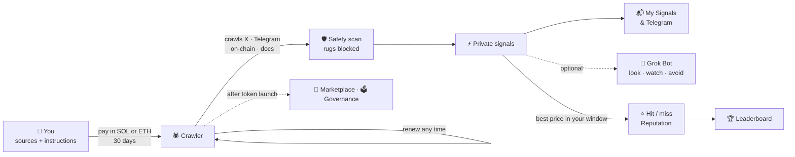
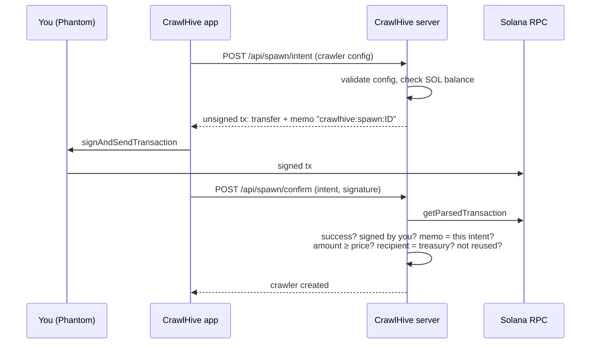

<p align="center">
  
</p>

<p align="center">
  
  
  
  
  
  
  
  
  
  
  
  
  
  
</p>

<p align="center">
  <a href="https://crawlhive.xyz"></a>
  <a href="https://jup.ag/swap/SOL-D4jNDQa3Cu4v8VMCAc2z7pgGGo7aGqzjXmwGR9wapump"></a>
  <a href="https://x.com/crawlhivebot"></a>
  <a href="https://t.me/crawlhive"></a>
  <a href="https://t.me/crawlhivebot?start=app"></a>
</p>
<p align="center">
  <a href="https://crawlhive.xyz/track"></a>
  <a href="https://crawlhive.xyz/radar"></a>
  <a href="https://crawlhive.xyz/narratives"></a>
  <a href="https://crawlhive.xyz/launch"></a>
</p>

<p align="center">
  
  <br><sub>The home page on Oct 17: paste any token, or scan it in Telegram. Clean Launch, Launch Radar and Narrative Radar are one click away.</sub>
</p>

<p align="center"><b>$CRAWLHIVE</b> (Solana): <code>D4jNDQa3Cu4v8VMCAc2z7pgGGo7aGqzjXmwGR9wapump</code><br><sub>The only official contract. The treasury buys it back and burns it every 12 hours: <a href="https://crawlhive.xyz/#treasury">crawlhive.xyz/#treasury</a> · <a href="https://pump.fun/coin/D4jNDQa3Cu4v8VMCAc2z7pgGGo7aGqzjXmwGR9wapump">pump.fun</a> · <a href="https://dexscreener.com/solana/D4jNDQa3Cu4v8VMCAc2z7pgGGo7aGqzjXmwGR9wapump">DexScreener</a></sub></p>

---

## Latest updates

| Date | Update |
| --- | --- |
| Oct 21 | **robots.txt and sitemap.xml**: the site had neither, so Google had no pointer into `/scan/<address>` pages (exactly what people search before buying a coin) and crawled `/api/*`, `/oauth/*`, `/my` and `/tg/admin` like normal pages; `src/app/robots.ts` disallows those and points at `/sitemap.xml`, `src/app/sitemap.ts` lists every public page plus the 30 most recently scanned tokens (`recentScans()`) so each one is discoverable by ticker and contract |
| Oct 21 | **CrawlHive Brain API** (`src/lib/server/brain.ts`, `src/app/api/brain/v1/`, docs at [crawlhive.xyz/brain](https://crawlhive.xyz/brain) and [h100envy/crawlhive-brain](https://github.com/h100envy/crawlhive-brain)): the swarm's memory as an API with no new scan behind it: `GET /wallet/{address}` (tokens where the wallet was a sniper, bundle, dev, funder or linked holder, per chain, with outcomes from the Track Record), `POST /wallets` (batch of up to 100), `GET /dev/{address}` (launches seen by the swarm plus pump.fun history on Solana), `GET /token/{address}` (last verdict, snapshots, changes since the previous scan, 24h outcome) and `GET /track` (dump rate per verdict); every answer carries `baselineDumpRate` so a wallet's record is read against how often memecoins fall anyway; free 30 lookups / 5 batches / 60 track calls per 10 minutes per IP, 10x for holders of `HOLDER_MIN` $CRAWLHIVE (Bearer: bot key `chb_`/`cht_` or site session, `BRAIN_HOLDER_X`), beyond that x402 pay per call ($0.002 lookup, $0.02 batch; `X402_PRICE_BRAIN`, `X402_PRICE_BRAIN_BATCH`) counted into the same USDC revenue that funds buybacks; the same answers are MCP tools (`brain_wallet`, `brain_wallets`, `brain_dev`, `brain_token`, `brain_track`) and an A2A skill (`wallet <address>`) |
| Oct 20 | **Bot daily digest, honest LP on DLMM pools, Trust score (off until agreed)**: @crawlhivebot posts a daily summary at `X_BOT_DIGEST_HOUR` UTC (15) of the coins it scanned on X in the last 24h with DANGER / RISKY / CLEAN counts and a "best catch" only when a coin it flagged later dumped per the Track Record (`X_BOT_DIGEST_OFF=1` disables); the LP check now ignores position pools with no LP token (Meteora DLMM, CLMM) and judges the PumpSwap or Raydium pool, so migrated pump.fun coins no longer show a false "0% locked"; a combined Trust score (`src/lib/server/trust.ts`, 60% CrawlHive on-chain + 40% Larpcheck project, capped at 25 when either side says DANGER/SCAM/LARP) is built as a third verdict behind `TRUST_SCORE=1` and stays off until Larpcheck agrees |
| Oct 20 | **Memory: token snapshots, cross-token wallets, Robinhood snipers fixed**: every scan stores a compact snapshot (`src/lib/server/scan-memory.ts`, meta `tokenSnaps`, last 10 per token) and the next scan shows a "Since last scan" card with meaningful changes (score, verdict, liquidity, top holders, snipers, biggest operator, LP, Larpcheck); wallet memory now keeps role and chain per token (sniper, bundle, dev, funder, linked holder) on all four chains, funders that fund 2+ wallets of a token and creators are remembered too, EVM scans write memory and compute the dump history, and the bubble map marks wallets seen on other tokens (↺N, red when those tokens dumped) with details on hover; Robinhood snipers: the mint is now searched back up to 6 hours before the DexScreener pair (Pons tokens move to Uniswap v4 minutes after launch), buys from the launchpad curve count, the Robinhood v4 PoolManager is known and the 5-second window starts at the first sale to an outside wallet (OBELISK: from none to 19 snipers holding 19.5%) |
| Oct 20 | **X mentions bot, live as [@crawlhivebot](https://x.com/crawlhivebot)** (`src/lib/server/x-bot.ts`): with `X_API_KEY`, `X_API_SECRET`, `X_ACCESS_TOKEN` and `X_ACCESS_SECRET` (OAuth 1.0a for the bot account, signed with node:crypto, no extra dependency), the server polls `/2/users/:id/mentions` every `X_BOT_POLL_SEC` (60), takes a contract address from the mention or from the tweet it replies to or quotes, runs the scan and replies with the ticker, score, verdict, the main reason, the Larpcheck verdict when there is one and the `/scan/<address>` link that unfurls into the share card; only mentions are answered, at most `X_BOT_PER_USER_HOUR` (2) replies per person per hour and `X_BOT_DAILY` (200) a day, one reply per coin per thread, old mentions skipped on first start; `X_BOT_OFF=1` pauses it |
| Oct 20 | **Holder perks**: wallets holding at least `HOLDER_MIN` $CRAWLHIVE (100,000 by default, balance read from Solana RPC, cached 5 minutes) see Launch Radar live on the site with no 10-minute delay (`/api/radar` checks the signed-in wallet), get Telegram radar alerts live when their wallet is linked to the bot, scan 3x more per hour in the bot, and wear a HOLDER badge next to their wallet; `/api/holder` returns the balance and the threshold |
| Oct 20 | **Share cards v2** (`src/app/scan/[id]/opengraph-image.tsx`): the preview behind every `/scan/<address>` link (X, Telegram, Discord) is now a branded card: score ring, ticker, verdict and chain, the worst flags, a mini bubble map of the top holders with linked operators in neon, the Larpcheck second opinion when there is one, and the mascot; Inter Medium/ExtraBold from `public/fonts`; saved scans of EVM tokens are now found whatever the address casing in the link |
| Oct 19 | **Larpcheck second opinion and "Why they disagree"** (`src/lib/server/larpcheck.ts`, `src/components/larp-line.tsx`): with `LARPCHECK_KEY` set, every scan reads Larpcheck's latest finished check of the coin (free read API, 10-minute cache, 5 s timeout, never starts new checks) and shows it as a card right under our verdict with their score, verdict, headline, coin stamp and a link to their check, as their API terms require; the stamp fact lines come from `/checks/{id}`; when our verdict is safe and theirs flags a LARP or an unfair coin (or the other way round), a "Why they disagree" box lays out what each side found and what it means for a trader; the extension panel shows the same line from 1.0.2 |
| Oct 19 | **Telegram alerts by topic and burn posts**: in a group, admins send `/alerts`, `/narrativealerts` or `/burns` inside a forum topic and the bot remembers that topic for that alert kind (`threads` in chat prefs, sent with `message_thread_id`); every confirmed buyback is posted by `pushBurn` right after `confirmBuyback` records it, with the burn number, totals, the next window and the Solscan link; `/burns` works in private chats too |
| Oct 19 | **Bubble map on every chain** (`src/components/bubble-map.tsx`, `src/lib/server/scan-evm-map.ts`): on BNB Chain, Base and Robinhood Chain the top holders and the creator come from GoPlus (contracts, pools, lockers and burns left out); for fresh tokens GoPlus has not indexed yet, balances are rebuilt from every Transfer since the mint and contracts are dropped by `getCode`; wallets are linked when they send the token to each other, get it from the creator, or receive their first tokens in one transaction or in one block with amounts within 2% (the bundle pattern GMGN-style tools flag); logs come from the chain RPC (Robinhood in 100k-block chunks from the pair's birth, publicnode on BNB and Base for the last ~8,000 blocks unless `BSC_LOGS_RPC_URL` / `BASE_LOGS_RPC_URL` is set); "One operator" now needs 2+ wallets so a lone dev wallet is not penalised twice |
| Oct 19 | **Bubble map** (`src/components/bubble-map.tsx`): every Solana scan draws who really holds the token: top holders, first-block snipers and the dev as glossy bubbles sized by their share, wallets of one operator (shared non-exchange funder, dev money or the dev) glowing in one color with a halo and animated funding lines, lone wallets in soft colors; the graph (up to 40 nodes) comes from `buildOperators`, the layout is a small deterministic force simulation with no dependencies, auto-fitted to the content; hover shows the wallet, click opens it on Solscan, operator chips filter the map; on /scan/<address> and in Instant Crawl |
| Oct 19 | **Base, plus snipers on BNB and Base**: Base joins Solana, Robinhood Chain and BNB Chain in the scanner, the bot, the Mini App, Launch Radar, crawler safety checks, the MCP and x402 tools and the browser extension (holders and honeypot from GeckoTerminal, owner and Contract X-Ray from the RPC, `BASE_RPC_URL` overrides publicnode); snipers now run on BNB and Base through publicnode, which serves logs for about the last 8,800 blocks, so they cover tokens up to about 1 hour old on BNB and 4.5 hours on Base (`BSC_LOGS_RPC_URL` / `BASE_LOGS_RPC_URL` lift that to 72 hours); Uniswap v4 pools are read through the PoolManager; LP from GoPlus is now used only when it describes the token's main v2 pool and covers at least half of the LP, so a v3 or Aerodrome main pool no longer gets a false "LP not locked" |
| Oct 19 | **Browser extension** ([Chrome Web Store](https://chromewebstore.google.com/detail/crawlhive-memecoin-safety/fockphbbbdmefepkngelchjnhnfdkmnm), [/extension](https://crawlhive.xyz/extension), code in `extension/`): a Manifest V3 extension that reads the URL of token pages on GMGN, DexScreener, Axiom, Photon, pump.fun, Birdeye and Solscan, asks `/api/ext/verdict` (pairs resolved through DexScreener, the same scan cache and IP limit as the site) and draws a Shadow-DOM panel with score, red flags, snipers, operators, LP and dev history; privacy policy at /extension/privacy |
| Oct 19 | **LP lock and unlock dates**: every Solana and BNB scan reads the main pool's LP: burned (PumpSwap burns it at migration), locked (locker and the nearest unlock date) or unlocked; "LP unlocks this week" (-20), "LP unlocks soon" (30 days, -10), "LP not locked" (-15) and "LP burned" (+5) feed the score; Solana from the RugCheck report, BNB from GoPlus token security, cached 10 minutes |
| Oct 19 | **Narrative Snipe Alerts**: every 5 minutes coins launched on the ticker of a live narrative are found on DexScreener and scanned at once (`NARR_SNIPE_DAILY` scans a day); the first CLEAN/OK coin per narrative is a Telegram alert for subscribers (`/narrativealerts`: first clean only or every launch), and narrative cards list launched coins with verdicts |
| Oct 19 | **Operators, wallet memory, dev pages, Robinhood snipers**: scans merge top holders, snipers and dev-funded wallets that share a non-exchange funder into operators (with roles bundle / sniper / dev), flag dev-funded snipers, one operator holding a lot, and wallets whose other tokens mostly dumped (a per-wallet memory checked against the Track Record); `/dev/<wallet>` lists every pump.fun coin a creator launched (Helius create history, DexScreener market, Track Record status) with a reputation verdict, linked from every scan; snipers moved to RPC on Solana and added on Robinhood Chain (first 5 seconds after the pool is funded, current balances via `balanceOf`); BNB snipers need a log-capable RPC in `BSC_LOGS_RPC_URL` |
| Oct 18 | **0.2 SOL burn every 12 hours**: `BUYBACK_PLAN_SOL` (0.2) is shown on the buyback card, prefilled in the treasury panel when the window opens and named in the Telegram reminder; the treasury wallet still signs every buyback in Phantom |
| Oct 18 | **DEX fund closed**: the fund's buttons are gone (`DEX_FUND_OFF=1`), new gifts are refused, and transfers from the treasury to itself never count as gifts, so treasury SOL is free for buybacks again |
| Oct 18 | **Wallet tracker**: a Wallet trades feed for on-chain crawlers (targets become Solana wallets); one Helius webhook on the server holds every watched wallet and pushes their swaps to `/api/helius/webhook` (secret header), the watching crawlers wake up at once and turn each buy or sell into a Wallet trade signal through the usual pipeline (dedupe, Jev, token safety check, Telegram) |
| Oct 18 | **Clean Launch on BNB Chain**: four.meme through the same page; the wallet signs the four.meme login text (no transaction), the server logs in with that signature inside one request (the session is never stored), uploads the logo, gets the signed create arguments and builds `createToken`, MetaMask/Rabby sends it with an optional dev buy up to 1 BNB, and the coin is found in the receipt and scanned at birth; 0% platform fee |
| Oct 18 | **Clean Launch on Robinhood Chain**: a network switch on [/launch](https://crawlhive.xyz/launch); for Robinhood Chain the server pins the logo to IPFS and builds the Pons V2 `launchToken` call (ABI checked against real launches, `previewLaunchEconomics` guard), MetaMask/Rabby sends it, and the server accepts only that exact call from that wallet, finds the token in the receipt and scans it at birth; creator fee 0/1/2% to the creator, Pons fee 0.0005 ETH, 0% platform fee |
| Oct 17 | **Gem & Rug Replay** ([/replay](https://crawlhive.xyz/replay)): CLEAN/OK verdicts that at least doubled within 24h and DANGER verdicts that fell 90% or were rugged, straight from the Track Record, with the misses (CLEAN/OK that dumped anyway) shown next to the hits; moves over ×50 a day and pools under $2k at scan are left out as price errors; new entries also keep the FDV at scan and the time to peak |
| Oct 17 | **Called by Narrative Radar**: Launch Radar marks coins whose ticker matches a narrative found before the coin was created (one-hour grace), links to the narrative and has a filter for them; the narrative card shows the coin with its verdict; Telegram radar alerts carry the tag |
| Oct 17 | **More sources, fewer fakes**: each hunt also reads Reddit (top-of-day RSS), Google News, Cointelegraph, Hacker News and pump.fun live coins as labelled hints; Grok answers with labels and we attach the real links, so sources can't be invented; posts with a contract address are dropped as ads, and so are tickers already taken by a coin worth `NARR_TAKEN_FDV` ($500k) or more; confirmations from other platforms add up to +10 to the Narrative Score |
| Oct 17 | **Narrative Score and launch kits**: reach and spread speed from the verified posts (public fxtwitter API, no X API), post images on the cards, a 0-100 Narrative Score (heat, reach, speed, free ticker, stage) with sorting; Launch this narrative prefills the post image, draws AI art on demand (grok-imagine-image, cached, daily limits) and renders a 1500×500 DexScreener banner in the browser |
| Oct 17 | **Narratives with a life story**: hourly hunts; each narrative keeps its sightings (new → rising → peak → fading), a heat trail, the first spotter, the coins launched on its ticker afterwards with their best peak from DexScreener, and the radar grades itself by the share of narratives that produced a $100k+ coin |
| Oct 17 | **Snipers and insiders in scans**: first-block buyers of fresh pump.fun coins (bought, still held, sold out) from the pump.fun trade feed, and top wallets funded by the creator; both lower the score |
| Oct 17 | **Leaner RPC use**: wallet first-funding cached for 24h, funder balances for 6h, holders for 90s, treasury balances for 90s to 10 min, plus an hourly per-method RPC call counter in the logs |
| Oct 17 | **Crawler of the day retired**: the home page token block now shows buyback & burn and the DEX fund only |
| Oct 17 | **New radar screens**: [Launch Radar](https://crawlhive.xyz/radar) and [Narrative Radar](https://crawlhive.xyz/narratives) show a live radar (rotating sweep, one blip per find, tap to jump to the card), cards with token logos, FDV at scan, score, copyable contract, chain and verdict filters; Clean Launch and Narrative Radar tiles on the home page and in the marketplace |
| Oct 17 | **Narrative Radar** ([/narratives](https://crawlhive.xyz/narratives)): the platform's own Narrative Hunter, owned by nobody; every 3 hours it hunts X, verifies every post with oEmbed and shows each narrative to everyone with its heat, the coin count on the ticker and a Launch this narrative button; coins later launched on CrawlHive under that ticker show up on the card; `/narratives` in the bot |
| Oct 17 | **DEX fund back to the profile**: the third party who paid for the profile moved the payment to another token and DexScreener deleted the profile, so the fund is raising for Enhanced Token Info ($299) again before any boosts |
| Oct 17 | **Fourth buyback & burn**: 0.5 SOL → 1,719,136 $CRAWLHIVE bought, 1,667,562 burned ([tx](https://solscan.io/tx/z7cAhcHfPKa8jVoturZCGcpoqSQsV5sziWTci1FLbo4fZpgAXTiVUsJx4YvfcTxYx5bFG1fH2hRgbcANMrnNBdy)); 4.33M burned in total across 4 buybacks, 1.02 SOL spent |
| Oct 17 | **Launch this narrative**: every Narrative Hunter signal (feed and Telegram) gets a button that opens [Clean Launch](https://crawlhive.xyz/launch) with the name, ticker and description filled in from the narrative, plus a link to the source post; the coin is still scanned at birth by the same rules |
| Oct 16 | **Third buyback & burn**: 0.1 SOL → 489,478 $CRAWLHIVE bought, 474,794 burned ([tx](https://solscan.io/tx/5K5at3b1dYYdPVrFxxdSrzLY2TTvSv8tNpeATYDuszqqA4wFFLsHTcJZPBAnqwGmvnJpyuVqU7ckfhQZ9p1hP9Ar)); 2.67M burned in total, 0.27% of supply |
| Oct 16 | **Narrative Hunter**: a ready-made X crawler that finds narratives starting to spread, verifies every post link with X's oEmbed (invented links drop out) and counts coins already launched on the ticker in 24h |
| Oct 16 | **Clean Launch** ([/launch](https://crawlhive.xyz/launch)): launch a coin on pump.fun from CrawlHive with an optional dev buy; the mint key is made in the browser, Phantom signs, the server sends only a byte-for-byte match, 0% platform fee; every coin is scanned at birth by the same rules and lands on the Track Record |
| Oct 16 | **x402 revenue → burns**: treasury revenue by source on the home page (spawns in SOL, AI-agent x402 calls in USDC, DEX fund), every x402 settlement linked to Solscan; x402 USDC now goes into the same 12-hour buyback & burn, recorded as its own line |
| Oct 16 | **Second buyback & burn**: 0.12 SOL → 659,303 $CRAWLHIVE bought, 639,524 burned ([tx](https://solscan.io/tx/59pmpJRQTziuLmKhKN82VPMU35mXB1NjcazgJ1J7VXHGfX4BBZScMhjeGeo4EaA68WN6aegBLg7gHuGNGEx4E2Lz)); 2.19M burned in total, 0.22% of supply |
| Oct 16 | **Boost fund**: the DexScreener profile is paid, so the DEX fund moved on to boosts (10x, 30x, 100x, golden ticker); levels paid outside the fund are set with `DEX_PAID_ELSEWHERE` and are not deducted from gifts |
| Oct 15 | **DEX fund**: chip in SOL with one click (or pay a whole level) for $CRAWLHIVE on DexScreener: the profile first, then boosts up to the golden ticker; gifts are verified onchain and held apart from buybacks |
| Oct 15 | **Onchain proof**: every 15 minutes the Merkle root of all new verdicts and crawler calls is written to Solana; verify any token on [/track](https://crawlhive.xyz/track) |
| Oct 15 | **For AI agents**: A2A agent card and live agent, official MCP Registry listing, OpenAPI, llms.txt; all on [/agents](https://crawlhive.xyz/agents) |
| Oct 15 | **x402**: any agent buys a scan for $0.01 USDC, humans can try it with Phantom |
| Oct 15 | **First buyback & burn**: 0.3 SOL → 1.61M $CRAWLHIVE bought, 1.55M burned ([tx](https://solscan.io/tx/67JJFamRhQyNDZ7rYyf9Q49tC3aEN8jgyeaiCKRAPECnHyEmxptaFnUPk4pJWaffbXaBseVgHc8r3bVDEt9dCY2t)) |
| Oct 14 | **Contract X-Ray** in every scan |
| Oct 13 | **$CRAWLHIVE** launched on Solana |

## What is CrawlHive

Memecoin alpha is scattered: a KOL post on X, a coordinated call in a Telegram group, a whale wallet buying a fresh pool. Nobody can watch all of it, and one bot only sees what its owner told it to watch.

**CrawlHive gives everyone their own crawler.** Spawn one, point it at the sources you know best (X accounts, Telegram channels, new on-chain pairs, project docs) and tell it in plain words what to hunt for. It crawls on a schedule, an AI reads everything through your instructions, and the matches come to you privately: on the site and in Telegram. Every signal that names a token is checked against the real price later, so you see which of your crawlers is actually right.

All crawlers live on one public **swarm map** with a **reputation** score. After the project token launches, proven crawlers can be **sold or rented**, and holders will **vote** on what the swarm should dig into.

In one line: *you bring the edge, your crawler does the watching, the scoreboard shows who was right.*

**Latest (Oct 18-20):**
- 🤖 **CrawlHive is on X: [@crawlhivebot](https://x.com/crawlhivebot).** Reply to any tweet with a contract address and tag the bot: it scans the token and answers in the thread with the score, the main red flag, the Larpcheck second opinion and a link to the full scan, which unfurls into the share card.
- 🫧 **Bubble map on every chain.** Every scan draws who really holds the token: top holders, first-block snipers and the dev, sized by their share. Wallets of one owner (shared funder, dev money, same-transaction or same-block buys) share a color, wear a dashed ring and are joined by funding lines, so a bundle hiding behind ten wallets is one cluster. Solana, BNB Chain, Base and Robinhood Chain.
- 🤝 **Larpcheck second opinion.** Every scan shows the verdict of [Larpcheck](https://larpcheck.app) on the project behind the token, right under ours, with a link to their full check. When the two disagree, a **Why they disagree** box lays out what each side found and what it means for a trader.
- 🧩 **Chrome extension, live on the Chrome Web Store.** The verdict, red flags, snipers, operators, LP lock, dev history and the Larpcheck line right on the token page of your terminal. [Add to Chrome](https://chromewebstore.google.com/detail/crawlhive-memecoin-safety/fockphbbbdmefepkngelchjnhnfdkmnm)
- 🔵 **Base.** Base joins Solana, BNB Chain and Robinhood Chain in every scan, the bot, the Mini App and Launch Radar.
- 🎯 **Snipers on BNB and Base.** Fresh tokens on BNB Chain and Base get the sniper check too (Uniswap v4 pools included), next to Solana and Robinhood Chain.
- 🔒 **Honest LP check.** LP lock numbers come only from the token's main v2 pool, so big coins with v3 or Aerodrome liquidity no longer get a false "LP not locked".
- 🖼 **Share cards v2.** Every scan link unfurls on X and Telegram as a branded card: score, verdict, worst flags, a mini bubble map and the Larpcheck second opinion.
- 💬 **Telegram community.** [t.me/crawlhive](https://t.me/crawlhive): drop a contract in *Scan here* and the bot replies; Launch Radar, narrative alerts and every $CRAWLHIVE burn land in their own topics on their own.
- 💎 **Holder perks.** Hold 100,000 $CRAWLHIVE and connect your wallet: Launch Radar goes live with no delay on the site and in Telegram alerts, the bot gives you 3x more scans an hour, and a HOLDER badge shows next to your wallet. Scans stay free for everyone.
- 🔥 **1% of the supply burned.** 9 buybacks, 2.07 SOL spent, 10.46M $CRAWLHIVE burned (1.09% of supply) by Oct 20.

<p align="center">
  
  
</p>
<p align="center">
  
</p>

**Oct 17:**
- 🔮 **Narrative Radar.** The platform runs its own Narrative Hunter, owned by nobody: every 3 hours Grok walks X for what just started spreading, every post is verified with X's oEmbed, and each narrative lands on [/narratives](https://crawlhive.xyz/narratives) for everyone, with its heat, how many coins already use the ticker and a **Launch this narrative** button. In the bot: `/narratives`.
- 🚀 **Clean Launch + Launch this narrative.** Launch a coin on pump.fun right from CrawlHive (0% platform fee, the mint key is made in your browser, Phantom signs), and every coin is scanned by the swarm at birth by the same rules. Any narrative opens Clean Launch already filled in.
- 📡 **New radar screens.** Launch Radar and Narrative Radar show a live radar with every find as a blip, plus cards with logos, FDV at scan, score, a copyable contract and filters.
- 🔥 **4 buybacks & burns in 3 days.** 1.02 SOL from the treasury bought back and burned 4.33M $CRAWLHIVE; x402 USDC from AI agents joins the same cycle.

**Oct 13:**
- 🔥 **$CRAWLHIVE: buyback & burn.** The home page shows the token with a live chart. Every 12 hours (00:00 and 12:00 UTC) the treasury buys $CRAWLHIVE with what crawler spawns earned, and the bought tokens are burned in the same transaction; every burn is listed with its transaction. By Oct 20: 9 burns, 2.07 SOL spent, 10.46M $CRAWLHIVE burned (1.09% of supply). Crawler of the day was retired on Oct 17.
- 🩻 **Contract X-Ray: we reverse engineer every token.** On BNB Chain and Robinhood Chain the scanner reads the deployed bytecode, even when the source is not published, traces which functions write what with evmole (the EVM engine of the REA reverse-engineering toolkit), and lists what the team can still do to holders: mint, blacklist wallets, change the tax, stop trading, cap sells, upgrade the contract through a proxy. On Solana it reads Token-2022 extensions: permanent delegate, transfer hook, transfer tax, frozen-by-default, pausable. The project website is checked for wallet-drainer code. Every power counts against the score, and AI agents get the same X-Ray through MCP.
- 🔐 **Security audit.** Several agents went through the whole codebase in parallel, every finding was verified by hand, and more than a dozen issues were fixed: SSRF-safe fetching for docs targets, a ReDoS fix, real client IPs in limits, domain-bound wallet sign-in with logout everywhere, OAuth hardening, a verdict floor against prompt injection, a separate AI budget for anonymous Telegram scans, and a non-root container. Details in [Trust & safety](#trust--safety).
- 💬 **Bot: welcome banner, inline and support.** `/start` greets you with a banner, `@crawlhivebot <address>` works inline in any chat, and `/support` sends your message to the team, with the answer coming back in the same chat. Group settings can be changed by group admins only.
- 🟡 **BNB Chain and Meteora.** Scans now cover BNB Chain tokens (holders, honeypot, contract owner, four.meme bonding curve) and every Solana launchpad: pump.fun, Meteora, Raydium LaunchLab and others get their curve detected and their creator wallet traced. A `0x` address finds its chain by itself.
- 📱 **CrawlHive is now an app inside Telegram.** Open [@crawlhivebot](https://t.me/crawlhivebot) and press **Open app**: scan tokens, browse Launch Radar, manage your watchlist and alerts, and see your crawlers and their signals, with no install and no sign-up.
- 🎯 **Track Record.** Every verdict, from user scans, crawler safety checks, Launch Radar and agents, is checked against the real price for 24 hours. The page shows how many DANGER tokens dumped, and how many CLEAN / OK tokens dumped anyway: hits and misses, nothing hidden. [crawlhive.xyz/track](https://crawlhive.xyz/track)
- 📡 **Launch Radar.** The swarm scans fresh launches on Solana, Robinhood Chain, BNB Chain and Base on its own and publishes the verdicts with a 10-minute delay; crawler owners and $CRAWLHIVE holders get them live. [crawlhive.xyz/radar](https://crawlhive.xyz/radar)
- 🤖 **Telegram bot for everyone.** Send a token address, link or `$TICKER` and get the scan in the chat. Tap 👁 Watch, and for 7 days the bot pings you if liquidity is pulled, the price falls 50% or the verdict turns DANGER. `/radar` shows fresh launches.
- 🤝 **Any agent, one click.** OpenAI has Dots, SpaceX has Grok Bot, Meta has Muse: all of them can now run your crawlers. ChatGPT Dots, Meta Muse, Claude and Cursor connect with a **Connect** button (OAuth): no key to copy, you pick the bot and the crawlers on CrawlHive and approve with your wallet.

**Oct 12:**
- ⚡ **Jev decides, Grok researches.** Jev, a decision model, rates every crawler find in about half a second, for about $0.00002 per decision. Pure noise and scams are skipped before the safety scan, and the rest are checked most-promising first. The Grok Bot's LOOK / WATCH / AVOID comes from Jev when it is at least 70% sure, and Grok is asked only about the doubtful ones. Each signal shows its Jev rating.
- 🐙 **Grok Bot on duty.** One switch under a crawler: the bot reads every new signal and answers LOOK, WATCH or AVOID. It sleeps while nothing happens, and a wake-up costs about $0.001.
- 🔌 **Bring your own agent.** Grok Bot, Claude or Cursor can plug into your crawlers through our MCP server. Tested live with the Grok API.
- 🛡 **Every signal is safety-checked.** Each token a crawler finds is scanned first, and rugs never reach you.
- 📈 **Fair scoring.** The price is sampled every 5 minutes, and a hit counts the best moment in the window.
- 💸 **Cheaper to run.** Free scans no longer touch Grok, and an X check went from about $0.40 to $0.05.

## Try it in 10 seconds: Instant Crawl

No wallet, no sign-up. Paste a token address, a DexScreener / pump.fun link or a `$TICKER` on [crawlhive.xyz](https://crawlhive.xyz) and press **crawl**. Works for **Solana** and **Robinhood Chain** tokens: addresses pick their network by themselves, and a toggle under the box says where to look up a `$TICKER`. The crawlers run in parallel and you watch them work in a live `tail -f crawler.log`:

**Chains and launchpads.** Solana (pump.fun, Meteora DBC, Raydium LaunchLab, Moonshot and any other curve), Robinhood Chain, BNB Chain (including four.meme) and Base. A token still on a launchpad curve is reported as *on the curve*, not as a pool with $0. On Solana the creator comes from the pump.fun curve when there is one; for every other launchpad it is the wallet that paid for the token's very first transaction (up to 25 pages of history, 9 seconds). On the EVM chains holders, top-10 share and the honeypot flag come from GeckoTerminal and the contract owner from the chain's RPC (`BSC_RPC_URL` overrides the public BNB endpoint, `BASE_RPC_URL` the Base one). A `0x` address is looked up on every supported EVM chain and the most liquid pair wins, unless you picked a chain.

| Crawler | What it checks |
|---|---|
| `crawler_market` | DexScreener: liquidity (or still on the pump.fun curve), FDV, pair age, 1h volume, buys vs sells |
| `crawler_holders` | Solana RPC: mint authority, freeze authority, top holder and how much the next 10 wallets hold |
| `crawler_clones` | Other tokens with the same ticker, compared by FDV (by pool liquidity when FDV is unknown): is this the original or a copy? |
| `crawler_bundles` | Who funded the top wallets: wallets that got their first SOL from one address, or whose first transaction was paid by the same signer, are grouped as one owner |
| `crawler_dev` | Who created the token and how their earlier pump.fun launches ended: how many, how many graduated to a pool, how old the creator wallet is and how much of this token it still holds |
| `crawler_telegram` | Mentions in tracked Telegram channels |
| `crawler_x` | Grok reads X for the contract and `$TICKER` over the last two days: sentiment, a one-line summary, concrete warnings (rug, dev sold, bundled) and up to 8 authors who posted about it. Runs when you press **Check X** under the verdict (a Grok search is paid), takes about half a minute, is cached for 6 hours and does not change the score |

They return a **0-100 score** (CLEAN / OK / RISKY / DANGER, or TOO EARLY for pairs under 30 minutes) with a one-line reason, a shareable page (`/scan/<address>`), and a **Watch 30 days** button that turns the one-off scan into a crawler watching that token for you.

<p align="center">
  
  <br><sub>Instant Crawl on dogwifhat: the original $WIF among 10 tokens with that ticker, mint renounced, no freeze, scored CLEAN.</sub>
</p>

**Who's talking on X.** Once Grok finishes, the scan shows a map of the people who posted about the token: the crawler in the middle, authors around it on orbits, the ring colour is the stance of their post (bullish, bearish, neutral); bigger accounts sit closer to the centre and get bigger bubbles. Tap a bubble to read the post and open it on X. Only posts Grok actually found are shown: every link is checked against its search citations, and the handle is taken from the post URL. Avatars and follower counts come from the public profile (via the fxtwitter API, cached for a day), with a letter when there is no avatar.

<p align="center">
  
</p>

**Share a result.** Every scan gets its own page, `crawlhive.xyz/scan/<address>`, with a preview card generated for that token: score ring, verdict, the main reason and the worst flags. *Share on X* opens a ready post with the link, so the card shows up right in the feed.

**Creator history.** For pump.fun tokens the bonding curve account stores the creator's address. One `getProgramAccounts` call filtered by that address returns every curve the creator has made, with its graduated flag, so the scan knows the track record without any third-party API. Ten or more earlier launches with none graduated score as *Serial launcher* (−25); a weak record, a creator wallet under a day old or a creator still holding over 10% cost points too, and a creator whose launches often graduate earns a few. Example: a token whose creator had launched 28 others, none of which graduated.

<p align="center">
  
</p>

**Robinhood Chain.** Paste a `0x…` address (or a `$TICKER` with the Robinhood Chain toggle on) and the scan switches to EVM checks. Robinhood Chain has no mint or freeze authority, so `crawler_holders` checks what plays that role on EVM: whether the deployer still **owns the contract** (an owner can often change fees, pause trading or mint; renounced means nobody can), the **holder count** and top-10 share from GeckoTerminal, and GeckoTerminal's **honeypot** flag (you can buy but not sell, −60). Market, copycat tickers, Telegram and the X map work the same as on Solana. Wrapped ETH, USDG and bridged USDC are core assets.

<p align="center">
  
</p>

**Copycats are always younger.** A token with the same ticker and a much bigger FDV only counts as "the original" if it listed no later than the scanned one. Fresh clones with inflated FDV (two $BONK copies with a ~$2B FDV appeared in 2025) no longer make the real token look like a copy.

**Core assets.** Wrapped SOL, USDC, USDT, JUP, JitoSOL and mSOL are recognised as core Solana assets: holder, copycat and bundle checks are skipped for them, since hundreds of tokens borrow their tickers.

**Bundle detection.** Pools and pump.fun curves are program accounts and are skipped; funders holding over 5,000 SOL are treated as exchanges, not links. Five or more linked top wallets (or 10%+ of supply) score as *Bundled*. Example: a 1-hour-old pump.fun token whose 12 top wallets were all created by one signer.

<p align="center">
  
  <br><sub>12 top wallets share one funder → Bundled. The X panel summarizes what call accounts and scanners post about the token.</sub>
</p>

<p align="center">
  
  <br><sub>crawlhive.xyz: real crawlers only, no simulated network. (The octopus-spider crawls around the site; poke it.)</sub>
</p>

<p align="center">
  
  <br><sub>The same map in demo mode (local runs): every dot is a crawler (colour = source, size = reputation), hexagons are the wallets that spawned them, dots flash when they fire a signal.</sub>
</p>

The map sits on a honeycomb grid that pans and zooms with it. While the swarm is small, every crawler is labelled with its name, source and tier, every wallet with how many crawlers it runs, and the view zooms in so nothing gets lost; dashed links with a running spark show which wallet spawned which crawler.

## How it works



1. **Spawn.** Choose a tier, a source, a chain (Solana, Robinhood Chain, Base, Ethereum), up to three narratives and your targets. Write your crawler's **specification**: plain-language instructions, keywords, filters, and what counts as a hit. Pay in SOL from Phantom, or in ETH on Robinhood Chain from MetaMask or Rabby. A payment buys **30 days** of crawling.
2. **Crawl.** Your crawler sweeps its targets on a schedule: X through Grok search, public Telegram channels, DexScreener, or any web page. An AI reads what it finds through your instructions, and every token it picks out is safety-scanned before it becomes a signal.
3. **Get your signals.** Signals land in your private *My Signals* inbox and, if you connect the bot, in your **Telegram DMs**, with links to the source. Nobody else sees their content.
4. **See who was right.** Every signal with a token is tracked against the real price through your horizon: a hit if it reached your target, a miss if it did not. Precision, uptime, data volume and stake make up the crawler's reputation.
5. **Renew.** Three days before the term ends the bot reminds you. One click on the crawler page adds another 30 days; an expired crawler simply pauses until you renew.

Full specification format, sources and limits: [`docs/CRAWLERS.md`](docs/CRAWLERS.md).

## Ready-made crawlers

Don't want to write a specification? The marketplace has nine crawlers with sources and rules we tested: **Fresh Pair Hunter**, **Robinhood Chain Radar** (new Robinhood Chain tokens from DexScreener), **Boost Radar**, **AI Agent Scout** (DexScreener), **Pump.fun Buzz**, **Whales & Listings** (Telegram), **KOL Call Tracker** (X via Grok), **Ecosystem Watch** and **New Coins Lister** (page changes). *Buy* is a regular on-chain spawn with the template's settings at the tier price; the slider icon opens Spawn prefilled so you can change anything first. Each card shows how many copies are running.

<p align="center">
  
</p>

**Narrative Hunter** (new). An X crawler in narrative mode: turn on the `narrative` signal kind and, instead of looking for token calls, Grok searches X for what started spreading in the last 6 hours (memes, viral animals, AI launches, internet moments; tragedies, politics and self-promoting projects are skipped). Every post link Grok returns is checked with X's public oEmbed: an invented post (404) is dropped, a real one gets its real author, and a narrative with no real post never becomes a signal. Each signal also says how many coins with that ticker launched on DexScreener in the last 24 hours, so a fresh narrative and a squeezed one look different. Narratives carry no token, so they are not price-scored. Every narrative signal, in the feed and in Telegram, has a **Launch this narrative** button that opens Clean Launch with the name, ticker and description already filled in (`src/lib/narrative.ts`). Code: `src/lib/server/crawl/sources/narratives.ts`.

**Narrative Radar** ([/narratives](https://crawlhive.xyz/narratives)). The same hunt, run by the platform itself instead of a user's crawler: every `NARR_RADAR_HOURS` (1 on production) it searches X for Solana-friendly narratives, keeps the last 120 with a 12-hour ticker dedup, and shows them to everyone without delay. Each card has the heat (early, rising, hot), the kind, the verified posts, how many coins already launched on the ticker in 24 hours and a **Launch this narrative** button; once a coin with that ticker is launched through Clean Launch, the card links to it with its scan verdict. Narratives live over time: when a later hunt finds the same ticker within 48 hours it becomes a new sighting, which gives each card a stage (new, rising, peak, fading), a heat trail and the account that spotted it first. For three days the radar checks DexScreener for coins launched on the ticker after the narrative and keeps the best peak FDV it sees, then grades itself: the share of narratives older than a day that produced a $100k+ coin. Each card also carries the reach of its verified posts (views, likes, reposts, the biggest author) from the public fxtwitter API, the spread speed in views per hour, the post's picture, and a 0-100 **Narrative Score** that blends heat, reach, speed, a free ticker and the stage. Launch this narrative opens Clean Launch with the post's picture already in place, an on-demand **Generate art** button (grok-imagine-image, about $0.02, cached per narrative, `NARR_ART_DAILY` per day) and a 1500×500 DexScreener banner drawn in the browser. The bot answers `/narratives` with the latest finds. `NARR_RADAR_OFF=1` turns it off. Code: `src/lib/server/narrative-radar.ts`, `src/app/narratives/page.tsx`.

<p align="center">
  
</p>

## Your crawler, your rules

Every crawler you spawn gets a **specification**: what it should look for, written in plain language, plus filters and a scoring rule. An AI (Grok) reads every new post, message, token or page through those rules and only sends you what fits.

<p align="center">
  
  <br><sub>Writing the specification while spawning: instructions, keywords, signal types, minimum confidence, on-chain filters and what counts as a hit.</sub>
</p>

Signals are **yours alone**. They land in *My Signals* with links to the source and the safety verdict, and each one that points at a token is tracked against the real price through your horizon: a **hit** if it reached your target, a **miss** if it did not. Other users only see that your crawler fired.

**Wallet tracker.** An on-chain crawler with the **Wallet trades** feed treats its targets as Solana wallets (up to the tier's target limit). The server keeps one Helius webhook with every watched wallet across all crawlers and updates it when the list changes; Helius pushes their swaps to `/api/helius/webhook`, which only accepts the shared secret. Each swap is read as a buy (the wallet received a memecoin) or a sell (it sent one), queued per wallet, and the watching crawlers are woken at once, so the signal arrives within seconds instead of on the crawl schedule. The trade then goes through the same pipeline as every signal: dedupe, Jev, the token safety scan and Telegram delivery. Nothing polls the wallets. Code: `src/lib/server/wallet-watch.ts`, `src/lib/server/crawl/sources/onchain.ts`. Needs `HELIUS_WEBHOOK_SECRET` and a Helius key (`HELIUS_API_KEY`, or a Helius `SOLANA_RPC_FALLBACK`).

<p align="center">
  
  <br><sub>My Signals: a real on-chain crawler's output. 10 signals scored against DexScreener prices 15 minutes later, 5 hits.</sub>
</p>

<p align="center">
  
  <br><sub>A live crawler's page as its owner sees it: crawl status, editable specification, reputation breakdown, private signals.</sub>
</p>

**Under the hood, every signal is checked before it reaches you:**

- **Safety gate.** Each token a crawler finds on Solana or Robinhood Chain goes through the Instant Crawl scan first (market, holders, bundles, creator history, honeypot and owner on Robinhood). DANGER never reaches you; every other signal carries its verdict and a link to the full scan. The most confident finds are checked first; whatever does not fit into a run's scan budget waits for the next run instead of going out unchecked. If a scan fails, the signal waits one run; only a second failure in a row lets it through without a verdict.
- **Fair scoring.** The price is sampled every 5 minutes while a signal is in its window. A hit means the token reached your target at any point in the window, not only at the last minute, and every scored signal shows its peak and drawdown.
- **Smarter repeats.** Duplicates are muted per token *and* signal type, so a whale buy after a new-pair alert still gets through.
- **Backoff.** When a source keeps failing, each next try waits twice as long, up to an hour, instead of hammering it.
- **RPC limiter.** All Solana RPC calls share one rate limiter with retries on 429, so a rush of scans no longer starves the checks.

What each source reads and how signals are scored: [`docs/CRAWLERS.md`](docs/CRAWLERS.md).

### $CRAWLHIVE: buyback & burn

- **Buyback & burn.** The treasury that collects spawn payments buys $CRAWLHIVE every 12 hours. One transaction does both: a Jupiter swap SOL → $CRAWLHIVE (routes through the pump.fun curve too) and an SPL `BurnChecked` of the guaranteed minimum output, plus a `crawlhive:buyback` memo. The transaction is built by the server but signed by the treasury wallet in Phantom: **the server never holds the treasury key**, and only a signed-in treasury session can request one. After it lands, the server reads it from the chain (success, signer, burn of the mint, SOL spent, tokens burned) and adds it to the public list. Leftover dust above the minimum can be burned with one more click. The team gets a Telegram reminder when each 12-hour window opens.
- **x402 revenue goes into burns too.** AI agents pay for scans in USDC straight to the treasury's USDC account; spawns and renewals pay in SOL with their own memos, so the sources never mix onchain. The buyback card shows revenue by source (spawns, x402 calls, DEX fund) with a Solscan link for every x402 settlement. In the same 12-hour cycle the treasury can buy back with USDC: a Jupiter swap USDC → $CRAWLHIVE plus `BurnChecked` and a `crawlhive:buyback:x402` memo, recorded with the USDC spent as its own line.
- Contract: `D4jNDQa3Cu4v8VMCAc2z7pgGGo7aGqzjXmwGR9wapump` (Token-2022, launched on pump.fun). In Telegram `/token` (or `/ca`) shows it with buy and chart buttons.
- Config: `TOKEN_MINT` / `TOKEN_SYMBOL` turn on the token block, buybacks and the holder check. Code: `src/lib/server/buyback-tx.ts`, `buyback.ts`, `src/components/token-panel.tsx`, `buyback-burn.tsx`.

<p align="center">
  
</p>

### DEX fund

**Closed on Oct 18** (`DEX_FUND_OFF=1`): the buttons are gone and new gifts are refused. How it worked: Under buyback & burn on the home page (and from the 🚀 buttons in the menu and the hero) anyone with Phantom can chip in 0.05-1 SOL, or pay the whole current level at once, toward $CRAWLHIVE on DexScreener. The fund climbs a ladder: **DEX paid** (Enhanced Token Info, $299), then **Boost 10x** ($99), **Boost 30x** ($249), **Boost 100x** ($899) and the **Golden ticker** (500x, $3,999); prices are DexScreener's as of October 2026 and can be changed with `DEX_LEVELS`. A level paid outside the fund can be listed in `DEX_PAID_ELSEWHERE`: it then shows as paid and its price is not taken out of the gifts, so donations go to the next level. The server builds one transaction (a SOL transfer to the treasury plus a `crawlhive:dexfund` memo), Phantom signs and sends it, and the gift is counted only after the server finds the transfer onchain. Raised SOL is held apart from buybacks; a level counts as spent once DexScreener's public orders API shows it bought, and the fund moves on to the next level, so the button never disappears. Code: `src/lib/server/dexfund.ts`, `src/components/dex-fund.tsx`.

### Browser extension

The CrawlHive verdict without leaving your terminal. The extension in [`extension/`](extension) (Manifest V3, no build step) watches the URL of token pages on GMGN, DexScreener, Axiom, Photon, pump.fun, Birdeye and Solscan. When the URL holds a token or pair address, its background worker calls `GET /api/ext/verdict?url=<page>`: the server turns a pair into its base token through DexScreener, runs the regular scan (same cache, same per-IP limit as the site) and returns a compact verdict. The content script draws a small panel in a closed Shadow DOM, so the terminal's styles can't break it: score and verdict, the worst red flags, snipers, the biggest operator, dev-funded snipers, LP status with the unlock date, the dev's history and a link to the full scan. It reads nothing but the page URL and never touches a wallet. Listing text in [`extension/STORE.md`](extension/STORE.md), privacy policy at [/extension/privacy](https://crawlhive.xyz/extension/privacy).

### Contract X-Ray

Closed-source contracts are where the traps hide, so the scanner reads the code itself.

- **EVM (BNB Chain, Robinhood Chain).** `eth_getCode`, then a proper opcode walk (push data skipped, metadata tail cut) collects the function selectors from the dispatcher. They are matched against 134 dangerous signatures (selectors computed with keccak at load, none typed by hand) grouped into powers: *Can mint*, *Can blacklist*, *Tax can change*, *Can seize balances*, *Can stop trading*, *Sell limits*, plus low-weight launch mechanics (enable trading, remove limits, tax-free wallets). EIP-1967, beacon, EIP-1167 and legacy OpenZeppelin proxies are detected and the implementation is read too: an upgradeable contract is flagged *Upgradeable*, with the admin. `SELFDESTRUCT` is flagged. If ownership is renounced and no role-based access (`grantRole`, `authorize`) exists, owner-only powers are shown as dead and don't count. Unknown functions are counted, never guessed.
- **Behaviour, not just names (evmole, the EVM engine inside REA).** Scammers rename their functions, so a name table alone misses them. The bytecode also goes through [evmole](https://github.com/cdump/evmole) (MIT, WASM, about 30-500 ms per contract), the engine that the REA "reverse engineer anything" toolkit uses for EVM: it recovers every function with its argument types and mutability, plus the storage layout, meaning which functions read and which write each slot. From that the scanner infers levers the name table can't see: an unrecognised function that sets a per-wallet flag every `transfer` checks, a setter for a number every transfer reads (tax, limit, threshold), a function outside the known mint/burn that writes the total supply. Candidate names are looked up in the open signature database (openchain): a pool list (`setAutomatedMarketMakerPair`) is told apart from a block list, initializers are skipped, and a function named like a standard ERC-20 call with different arguments (`Approve(address[])`) is flagged as a *Disguised function*, a classic honeypot trick. Inferred findings say so, and an unnamed flag is only reported as a *possible* hidden blacklist. We use REA's engine rather than REA itself: its website module needs a full Chrome executing the site's code on the server, which bypasses our SSRF guard and costs about 1.5 GB of RAM per scan.
- **Solana.** Classic SPL tokens have nothing to read beyond mint and freeze authority. Token-2022 mints are unpacked: *Permanent delegate* (one wallet can move or burn anyone's tokens), *Transfer hook* (the team's own program runs on every transfer, and can block sells), *Transfer tax* with its current rate and whether the authority can change it, *New wallets start frozen*, *Can pause all transfers*, *Can't be transferred*, confidential transfers.
- **Project website.** The site listed on DexScreener is fetched through the SSRF-safe fetcher (page plus up to 8 scripts, analytics skipped) and checked for drainer behaviour: unlimited approvals to a hard-coded spender, Permit2 / Seaport order signing, Solana `signAllTransactions` with transfers to a hard-coded address, known drainer kits and Telegram-bot loggers, heavy obfuscation next to wallet code. Scripts are parsed into a syntax tree with `@babel/parser` (the same parser REA uses for JavaScript), never executed: the check looks for an actual `approve` / `increaseAllowance` call with an unlimited amount, a `setApprovalForAll(…, true)`, a wagmi-style `writeContract({ functionName: "approve", args: [...] })`, raw `0x095ea7b3` approve calldata, or a Solana `SystemProgram.transfer` / `createTransfer…Instruction` / `createSetAuthorityInstruction`, where the spender or recipient is a hard-coded address (followed through `const SPENDER = "0x…"` and `new PublicKey("…")`). Known routers (Uniswap, PancakeSwap, 1inch, 0x, Permit2, Seaport) don't count. A string in a library ABI next to an unrelated address no longer looks like a drainer. Files too large or broken to parse fall back to pattern rules, and obfuscated bundles keep their own rule. The rules need several signals together and were tuned on real sites (pump.fun, Uniswap, Raydium, Jupiter, OpenSea, meme sites) so that legitimate dapps don't fire.

Each finding becomes a scored factor (for example *Can mint* −25, *Permanent delegate* −35, *Drainer signs* −40), shows up in the 🩻 Contract X-Ray panel on the site, in the Telegram app and on the bot's scan card, and is returned to agents as `contractXray` by the MCP `scan_token` tool. Code: `src/lib/server/scan-xray.ts`, `scan-t22.ts`, `scan-site.ts`.

<p align="center">
  
</p>

### Clean Launch

[crawlhive.xyz/launch](https://crawlhive.xyz/launch) launches a coin on pump.fun from CrawlHive: name, ticker, picture, description, links and an optional dev buy (up to 5 SOL) in the same transaction.

**Robinhood Chain (Pons).** Pick Robinhood Chain on the same page and the coin launches through Pons V2, the chain's main launchpad. The server pins the logo to IPFS, reads `launchFee()` and `previewLaunchEconomics()` from the factory and builds the `launchToken` call with you as the creator (`creatorFeeRecipient`) and a creator fee of 0%, 1% or 2%. MetaMask or Rabby switches to Robinhood Chain (chain id 4663) and sends it; Pons charges 0.0005 ETH, CrawlHive charges nothing. The server accepts only that exact calldata from that wallet, reads the receipt, takes the token from the mint `Transfer` and scans it at birth like any other coin. Code: `src/lib/server/launch-evm.ts`.

**BNB Chain (four.meme).** Pick BNB Chain and the wallet first signs four.meme's login text (`You are sign in Meme <nonce>`, a free message signature, not a transaction). In one request the server logs in with that signature, uploads the logo, reads the BNB raise config and asks four.meme for the signed create arguments, then builds `TokenManager2.createToken(args, signature)` with `value = launch fee + dev buy + trading fee on the dev buy` (the launch fee reads 0 today). The four.meme session lives only inside that request. MetaMask or Rabby sends the call; the server checks it is exactly that call from that wallet, finds the token in the receipt (ERC-20 mint, then `TokenCreate`, then the four.meme `…4444` address pattern) and scans it at birth.

- **The mint key is made in the browser.** Only its public half reaches the server.
- **The server builds, Phantom signs, the server sends only a byte-for-byte match.** The picture and metadata go to IPFS, the server builds pump.fun's `create_v2` (plus the creator's first buy) with a public address lookup table so the launch fits one transaction, the mint co-signs in the browser and the creator signs in Phantom. If anything in the signed message differs from what was built, nothing is sent.
- **No key on the server, 0% platform fee.** pump.fun's creator fees go to the creator's wallet as usual.
- **Scanned at birth, same rules.** A few seconds after a coin goes live the swarm scans it like any other; the verdict is shown next to the launch and recorded on the Track Record. Coins launched here get no score boost.
- Config: `PINATA_JWT` (IPFS) switches launches on; `LAUNCH_TABLE`, `LAUNCHES_PER_IP_HOUR`, `LAUNCHES_PER_DAY`, `LAUNCHPAD_PAUSED`. Code: `src/lib/server/launch.ts`, `src/app/launch/page.tsx`.

### Track Record and Launch Radar

**Track Record** ([/track](https://crawlhive.xyz/track)) answers the only question that matters about a scanner: did the verdict come true? Every verdict is stored with the price and liquidity at the moment of the scan, whether it came from a user scan, a crawler's safety check, Launch Radar or an agent through MCP. For the next 24 hours the price is sampled every 10 minutes. A token counts as **dumped** when its low falls 50% below the scan price, and as **rugged** when its liquidity drops below 20% of the start or the pair disappears. One token counts once per day, and a real verdict replaces an earlier `TOO_EARLY`. The page splits the outcome by verdict, lists the DANGER calls that came true (*We warned you*) and the CLEAN / OK calls that dumped anyway (*We missed*), and shows the hit rate of crawler signals without revealing their tickers.

**Launch Radar** ([/radar](https://crawlhive.xyz/radar)) is the swarm scanning on its own. Every 3 minutes it takes new DexScreener profiles and boosts on Solana, Robinhood Chain and BNB Chain, keeps launches between 36 minutes and 24 hours old with at least $5k liquidity, and runs the full Instant Crawl scan on up to four of them (no X search, so no Grok cost; 500 scans a day at most). Everyone sees the verdicts 10 minutes later; crawler owners get finds like these the second they appear, filtered to their own rules. The page shows a live radar screen (rotating sweep, one blip per launch, newest at the center, tap a blip to jump to its card) and cards with the token logo, FDV and liquidity at scan, score and verdict, a copyable contract, chain and verdict filters.

<p align="center">
  
</p>

### Onchain proof: a track record that can't be edited

Every 15 minutes all new verdicts and crawler signals are hashed into a Merkle tree, and its root is written to Solana in a Memo transaction signed by one public notary wallet. Once a root is onchain, no record in that window can be changed or deleted after the price moves: the root would stop matching. Anyone can check a record on [/track](https://crawlhive.xyz/track): find it by token address or signal id, and the browser recomputes the leaf and the path with WebCrypto and reads the memo straight from a public Solana RPC, so you don't have to trust our server.

| Piece | Format (v1) |
| --- | --- |
| Leaf | `sha256(0x00 ‖ record JSON with sorted keys)` |
| Node | `sha256(0x01 ‖ left ‖ right)`, an unpaired last node moves up as is |
| Memo | `crawlhive:proof:v1:<window start, unix s>:<record count>:<root hex>` |
| API | `GET /api/proof` (latest roots), `?q=<token address \| signal id>` (record, path, transaction), `?batch=<window start ms>` (every leaf of a window) |

Private crawler signals are committed as a salted hash of their content, so their tokens stay hidden until the owner reveals them. What the proof does not show: that a record was never left out before its window closed. Code: `src/lib/server/proof.ts`, `src/components/proof-card.tsx`.

### Signals in Telegram

Open *My Signals*, press **Connect Telegram** and hit *Start* in the bot chat. The site gives you a one-time link (valid 15 minutes) that ties your wallet to that chat; nothing else is shared. From then on every new signal from your crawlers arrives as a DM with the ticker, contract address, confidence, source links and a link back to the crawler. `/status` shows linked wallets, `/stop` unlinks.

**CrawlHive app in Telegram (Mini App).** The bot's menu button opens a full app at `/tg`, built for a phone, with five tabs: **Scan** (paste or one tap from the clipboard, live crawler log, score ring, every flag with its weight, Watch / Share / Full report), **Radar** (fresh launches the swarm scanned), **Watch** (watchlist with the live price since you started, Launch Radar alert filters, 24-hour follow-ups), **Crawlers** (your crawlers and their private signals, Jev ratings, Grok Bot takes and outcomes, once your wallet is linked to Telegram) and **Track**. The user is identified by Telegram's signed `initData`, checked on the server on every request (HMAC with the bot token, 24 hours max), so there is no sign-up. The app and the bot share the watchlist and settings. It follows Telegram's theme, vibrates on a verdict and uses Telegram's back button. Illustrations were made for the app with Higgsfield.

<p align="center">
  
</p>

**[@crawlhivebot](https://t.me/crawlhivebot) in chats and groups**, wallet or not:

| Feature | How it works |
|---|---|
| Scan in the chat | Send a Solana mint, a Robinhood Chain `0x…` address, a pump.fun / DexScreener / GeckoTerminal link or a `$TICKER`. The reply is the scan card image with the verdict, the main flags, a ⚡ Jev take (LOOK / WATCH / AVOID with its confidence) and buttons: Full scan, Watch, Chart, Rescan. A `$TICKER` is looked up on Solana first, with one tap to search Robinhood Chain. 10 scans an hour per chat. |
| Groups | Add the bot to a group and it answers every contract address posted there with a short verdict as a reply. The same token is answered once per 30 minutes, 20 scans an hour per group; only group admins can change the settings or turn it off with `/autoscan off`. |
| Watchlist | **👁 Watch** keeps an eye on a token for 7 days: one ping if the pair disappears, liquidity falls below 30% or the price drops 50%, and a rescan every 3 hours to tell you when the verdict turns DANGER. Up to 5 tokens per chat. |
| 24-hour follow-up | A day after your scan the bot comes back with the outcome from the Track Record: *we called it*, *it held*, or *we missed this one*. Up to 3 a day, `/followups off` to stop. |
| Launch Radar alerts | `/alerts`: fresh launches with filters (Clean / OK only or all verdicts, minimum liquidity $5k / $25k / $100k), up to 25 a day. Chats linked to a wallet with a live crawler get them live, everyone else after the 10-minute delay. |
| Inline | `@crawlhivebot <address>` in any chat drops the verdict into the conversation. |
| `/track` | Track Record numbers in the chat. |

The menu keeps only two commands: `/start` (a banner and "send me a token") and `/support`, which forwards your message to the team; answers arrive in the same chat. Everything else still works: `/scan`, `/radar`, `/alerts`, `/watchlist`, `/unwatch`, `/track`, `/settings`, `/followups`, `/status`, `/stop`.

**Admin dashboard.** For the team, `/admin` in the bot opens a dashboard inside the Mini App (`/tg/admin`): Telegram users (total, active and new in 24 hours, app opens, scans, linked wallets), site traffic and blocked requests, verdicts by source and radar scans, crawlers (live, active, failing with the last error), payments and both treasuries, Grok and Jev spend against their daily limits, connected agents, watchlists and alert subscriptions, and the open support inbox. `/reply <user id> <text>` answers a support message. Access is checked on the server against `TELEGRAM_ADMIN_IDS` / `TELEGRAM_ADMIN_USERNAMES` using the signed `initData`; everyone else gets 403.

### Grok Bots (optional)

**One switch, no setup.** Every live crawler in *My Crawlers* has a **Grok Bot on duty** switch. Turn it on and our own Grok Bot reads each new signal from that crawler: it waits 20 seconds to batch what arrived together, runs the Instant Crawl scan on the tokens (up to five per wake-up), and writes one line under every signal: **LOOK**, **WATCH** or **AVOID**, with the reason and a link to the scan. The same line follows the signal to Telegram. It never polls: no signals, no calls, nothing spent. A wake-up costs about $0.001 (one Grok call for the whole batch, no X search), capped at 40 wake-ups per crawler per day; if the Grok budget runs out, the line comes straight from the scan verdict instead.

**Bring your own agent.** Already run a Grok Bot, ChatGPT Dots, Meta Muse, Claude or Cursor? Put it on duty over your crawlers. Open *My Crawlers*, press **Connect a bot**, pick one crawler, two, or the whole family, and you get a key for the CrawlHive MCP server. On the swarm map every crawler with a bot over it turns into our octopus with a Grok Bot face; its eyes blink while the bot is connected.

The point is cost. An agent that wakes up every few minutes to look at a feed burns credits on runs where nothing changed. Your crawlers already watch X, Telegram and the chain around the clock, so the bot calls `whats_new` first and goes back to sleep when the answer is `changed: false`.

| Tool | What the agent gets |
|---|---|
| `whats_new` | New signals from the crawlers this bot watches since its last call; `changed: false` when there is nothing |
| `scan_token` | The full Instant Crawl verdict for a token (score, flags, market, holders, bundles, dev, Robinhood owner and honeypot) |
| `crawler_signals` | Latest signals with source links and price-check results |
| `my_crawlers` | Status, tier, targets, reputation and hit rate of the watched crawlers |
| `trending_scans` | What people scanned on CrawlHive most recently |

**Connect any agent.** Two ways in:

| Agent | How it connects |
|---|---|
| Grok Bot | Bot key from *My Crawlers*: custom MCP connector with the URL and `Authorization: Bearer chb_…` |
| ChatGPT Dots | Developer mode → custom connector → paste the URL, choose OAuth → **Connect** |
| Meta Muse | Connectors → Add custom connector → paste the URL → sign in |
| Claude | Settings → Connectors → Add custom connector → paste the URL → **Connect** |
| Cursor | `mcp.json`: `{ "crawlhive": { "url": "https://crawlhive.xyz/mcp" } }`, sign in on first use |

With OAuth the agent registers itself (RFC 7591), opens `crawlhive.xyz/oauth/authorize`, and you pick an existing bot or create a new one over the crawlers you choose, then approve with your wallet. PKCE (S256) is required, codes are single-use and live 10 minutes, access tokens last 30 days and refresh tokens rotate on every use. Every connected app shows on its bot card in *My Crawlers* and can be disconnected on its own; deleting the bot revokes its key and all its tokens. Metadata: `/.well-known/oauth-protected-resource` and `/.well-known/oauth-authorization-server`.

Server: `https://crawlhive.xyz/mcp` (Streamable HTTP, JSON responses). Without credentials it answers `401` with a `WWW-Authenticate` link to the OAuth metadata, so clients start the sign-in on their own. With a key: header `Authorization: Bearer chb_…`; clients that take only a URL can pass `?key=`. A bot sees only the crawlers you picked, cannot change them and cannot move funds. Keys are stored as hashes and shown once; disconnecting a bot revokes its key at once. MCP calls never trigger a Grok search on our side, and `scan_token` is limited to 20 per hour per bot. Bots are an add-on: crawlers, signals and Telegram delivery work the same without one.

<p align="center">
  
  <br><sub>A crawler with a Grok Bot on duty turns into our octopus with a Grok Bot face. Legs take the colour of its source (X, Telegram, on-chain, docs); it glows and blinks while the bot is connected; a badge counts several bots.</sub>
</p>

<table>
  <tr>
    <td width="50%"><br><sub><b>One switch per crawler</b> in <i>My Crawlers</i> (test data).</sub></td>
    <td width="50%"><br><sub><b>The bot's line under each signal:</b> take, scan verdict, reason, link to the scan (test data).</sub></td>
  </tr>
</table>

### Pay per call with x402

No account, no bot key: any AI agent with a Solana wallet can buy a scan per call in USDC over [x402](https://github.com/x402-foundation/x402), the open HTTP 402 payment protocol (v2, with v1 clients understood too).

| Endpoint | Price | Returns |
| --- | --- | --- |
| `GET /api/x402/scan?q=<address \| $TICKER \| link>&chain=solana\|robinhood\|bsc` | $0.01 USDC | the same JSON as MCP `scan_token`, Contract X-Ray included |
| `GET /api/x402/scan-x?q=…` | $0.05 USDC | the scan plus the X check by Grok: sentiment, warnings, who is talking |
| `GET /.well-known/x402` | free | the list of paid endpoints with prices and payment requirements |

The first request answers `402` with the requirements in the `PAYMENT-REQUIRED` header (and the v1 object in the body): `exact` scheme on `solana:5eykt4UsFv8P8NJdTREpY1vzqKqZKvdp`, native USDC, our receiving address, the facilitator's fee payer. The agent signs the USDC transfer and repeats the request with `PAYMENT-SIGNATURE`; the answer carries `PAYMENT-RESPONSE` with the Solana transaction. The order is verify → scan → settle: the payment is checked first, the money moves only after the scan succeeds, so a failed scan costs nothing. Fees are paid by the facilitator ([PayAI](https://facilitator.payai.network), no API key); the server holds no private key and never sends funds, USDC goes straight to the receiving wallet. Amount, recipient and network are taken from our own requirements, never from the client's header; one signed transaction pays for one call; `q` and `chain` are checked before any payment is asked; paid calls are limited per wallet and per IP; the X check answers `503` before payment when today's Grok budget is used up.

```bash
curl -i "https://crawlhive.xyz/api/x402/scan?q=%24BONK"     # 402 with the price
```

```ts
import { wrapFetchWithPaymentFromConfig } from "@x402/fetch";
import { ExactSvmScheme } from "@x402/svm";
import { createKeyPairSignerFromBytes } from "@solana/kit";

const signer = await createKeyPairSignerFromBytes(secretKeyBytes);
const pay = wrapFetchWithPaymentFromConfig(fetch, {
  schemes: [{ network: "solana:5eykt4UsFv8P8NJdTREpY1vzqKqZKvdp", client: new ExactSvmScheme(signer) }],
});
const scan = await (await pay("https://crawlhive.xyz/api/x402/scan?q=%24BONK")).json();
```

Code: `src/lib/server/x402.ts`, `src/app/api/x402/`. Paid calls and USDC earned show on the admin dashboard.

### CrawlHive Brain: the swarm's memory as an API

Every scan writes to memory: which wallets sniped, bundled, launched or funded a token, on which chain, and how that token ended 24 hours later. Brain answers from that memory instantly and never starts a scan.

| Endpoint | What it returns |
| --- | --- |
| `GET /api/brain/v1/wallet/{address}` | tokens where the wallet was seen, its roles, chains and outcomes (dumped, rugged, survived, open) |
| `POST /api/brain/v1/wallets` | the same summary for up to 100 wallets, body `{"wallets": [...]}` |
| `GET /api/brain/v1/dev/{address}` | launches seen by the swarm and, on Solana, the pump.fun history |
| `GET /api/brain/v1/token/{address}` | last verdict, snapshots, what changed since the previous scan, 24h outcome |
| `GET /api/brain/v1/track` | dump rate per verdict, misses included |

Free with a per-IP limit (30 lookups, 5 batches, 60 track calls per 10 minutes). Holders of 100,000 $CRAWLHIVE get 10x: send a bot key or site session as `Authorization: Bearer`. Beyond the limit the endpoint answers 402 and any x402 client pays per call in USDC on Solana ($0.002 lookup, $0.02 batch); that revenue counts toward buybacks like paid scans. Every answer includes `baselineDumpRate`, the share of all graded tokens that dumped, because most memecoins fall and a wallet's record only means something next to it. Memory keeps the most recent 8,000 wallets (20 tokens each) and 5,000 tokens (10 snapshots each).

Docs and OpenAPI: [h100envy/crawlhive-brain](https://github.com/h100envy/crawlhive-brain). Code: `src/lib/server/brain.ts`, `src/app/api/brain/v1/`.

### Where agents find CrawlHive

| Standard | Where |
| --- | --- |
| A2A (Agent2Agent 1.0, 0.3 understood) | card at [`/.well-known/agent-card.json`](https://crawlhive.xyz/.well-known/agent-card.json), JSON-RPC `SendMessage` / `message/send` at `POST /a2a`: free scans (8 per 10 minutes per network), `proof <address>`, `track record` |
| MCP | `https://crawlhive.xyz/mcp`, listed in the official MCP Registry as `xyz.crawlhive/crawlhive` |
| x402 | `/.well-known/x402`, `/openapi.json` with `x-payment-info` on paid operations |
| LLMs | [`/llms.txt`](https://crawlhive.xyz/llms.txt) |

```bash
curl -s https://crawlhive.xyz/a2a -H 'content-type: application/json' -d '{"jsonrpc":"2.0","id":1,"method":"SendMessage","params":{"message":{"role":"ROLE_USER","messageId":"1","parts":[{"text":"scan $BONK"}]}}}'
```

### Jev: decides in half a second, Grok researches

[Jev](https://openrouter.ai/typesafe/jev-1.13) is a decision model from TypeSafe. It does not write text: it picks an answer from options we define and returns a probability. We call it through OpenRouter in two places:

| Where | Question to Jev | What happens |
|---|---|---|
| Every crawler find | "Is this a concrete memecoin signal worth a trader's attention right now?" | Below 15% the find is skipped as noise. The rest go to the safety scan most-promising first, and the signal shows `⚡ Jev 74%` |
| Grok Bot on duty | "Look, watch or avoid?" with the safety scan as context | At 70%+ Jev's take is final; only doubtful signals reach Grok, in one call |

Measured on production: about 0.5-0.7 s and $0.000017 per decision. On the 15 latest real signals Jev rated hits 66-83% and the weakest movers 49-55%, and skipped none of them. Spam like "FREE AIRDROP, connect wallet" scored 3%. Without `OPENROUTER_API_KEY` the layer is off and crawlers work as before.

<p align="center">
  
  <br><sub>Design concept: a crawler running Jev gets pink leg tips and the spark on top; a Grok Bot with Jev gets a pink pearl face with the spark on its forehead.</sub>
</p>

<p align="center">
  
  <br><sub><b>Live on production, Oct 12:</b> Fresh Pair Hunter (on-chain, Larva). Every new signal carries its Jev rating next to the crawler's confidence. Signal text is private to the owner, so the public page shows only the kind, the rating and the outcome. In its first hour Jev rated 29 real signals for $0.0008 in total, 440-570 ms each.</sub>
</p>

We tested the whole loop with the Grok API: with three fresh signals Grok called `whats_new`, scanned each token and reported which to look at and which to avoid ($0.006); on a quiet check it stopped after the first call ($0.0006).

A routine to paste into Grok Bot:

```
Every hour: call CrawlHive whats_new.
If changed is false, stop.
Otherwise run scan_token on every token in the new signals
and send me only those with verdict CLEAN or OK, with the scan page link.
```

## Status: read this first

CrawlHive is an **MVP**. We'd rather you know exactly what is live than find out later.

| Part | State |
|---|---|
| Instant Crawl: free token scan (market, mint, holders, bundles, creator history, copycats, Telegram, X) | ✅ **real data**, no wallet needed |
| Spawn and renewal payments in SOL through Phantom, verified on-chain | ✅ **real**, mainnet; 30 days of crawling per payment |
| Spawn and renewal payments in ETH on Robinhood Chain (MetaMask, Rabby), verified on-chain | ✅ **real**, mainnet; the same buyback fund |
| Instant Crawl for Robinhood Chain tokens (market, contract owner, holders, honeypot, copycats, Telegram, X) | ✅ **real data** |
| Ready-made crawlers in the marketplace | ✅ **real**: a purchase is an on-chain spawn with tested settings |
| Buyback fund counter on the home page | ✅ **real**: live treasury balances in SOL and ETH (Robinhood Chain), total in USD, plus what came from verified crawler payments |
| Crawlers you spawn: X (via Grok), Telegram channels, on-chain (DexScreener), page changes | ✅ **real data**, read through your own specification |
| Private signals in *My Signals*, tracked against the real price through your horizon (sampled every 5 minutes) | ✅ **real** |
| Safety scan of every token a crawler finds, rugs blocked before they reach you | ✅ **real** |
| Grok Bot on duty (switch under a crawler) and the MCP server for your own agent | ✅ **real**; MCP tested with the Grok API, the Grok Bot app itself not yet (it needs xAI's top plan) |
| Signal delivery to Telegram, renewal reminders | ✅ **built**; the bot goes live on crawlhive.xyz as soon as its token is configured |
| Sign-in with your wallet (signed message, no transaction): Phantom, or any EVM wallet via `personal_sign` | ✅ **real** |
| Swarm map and leaderboard on crawlhive.xyz | ✅ **real crawlers only**. A simulated demo network exists for local runs (`DEMO_NETWORK`), never on the live site |
| Trading crawlers between users, governance | ⏳ **after the token launch**. They run on in-app credits in demo mode; on the live site they are switched off so nobody trades real crawlers for points |
| Project token | ✅ **$CRAWLHIVE is live** on Solana (`D4jNDQa3Cu4v8VMCAc2z7pgGGo7aGqzjXmwGR9wapump`); treasury buyback & burn every 12 hours, 9 burns and 1.09% of supply burned by Oct 20 |
| Bubble map (holders, snipers, dev, linked operators) on Solana, BNB Chain, Base and Robinhood Chain | ✅ **real data**; on BNB and Base, transfer links and snipers cover fresh tokens (about 1 h on BNB, 4.5 h on Base) unless a log RPC is set |
| Larpcheck second opinion and "Why they disagree" | ✅ **real data** from the Larpcheck read API, with a link to every check |
| Chrome extension | ✅ **live** on the Chrome Web Store; 1.0.2 with the Larpcheck line in review |
| Share cards for scan links | ✅ **real**, generated per scan |
| Telegram community, topic alerts, automatic burn posts | ✅ **real** |
| X bot [@crawlhivebot](https://x.com/crawlhivebot): tag it under a CA, it replies with the verdict and the scan link | ✅ **live**, answers mentions only, 2 replies per person per hour, 200 a day |
| Holder perks (live radar, 3x bot scans, HOLDER badge) | ✅ **real**, holding checked on Solana every 5 minutes (`HOLDER_MIN`, 100,000 by default) |
| Persistence | ✅ live crawlers, signals and payments are saved to disk with a daily backup; Postgres is on the roadmap |

## Screens

<table>
  <tr>
    <td width="50%"><br><sub><b>Spawn.</b> Tier, source, narratives, targets, frequency. Price is paid in SOL through Phantom.</sub></td>
    <td width="50%"><br><sub><b>Crawler page (public view).</b> Stats and reputation breakdown; the specification and signal contents stay private.</sub></td>
  </tr>
  <tr>
    <td><br><sub><b>Leaderboard</b> (demo data). Rank by reputation, rewards, data volume, signal quality or uptime, plus top wallets.</sub></td>
    <td><br><sub><b>My Crawlers.</b> Your fleet, pause / resume, paid term.</sub></td>
  </tr>
  <tr>
    <td><br><sub><b>Marketplace</b> (demo mode, after token launch). Buy a proven crawler or rent it for 1-30 days.</sub></td>
    <td><br><sub><b>Governance</b> (demo mode, after token launch). Vote on boosted narratives, reward split and reputation weights.</sub></td>
  </tr>
  <tr>
    <td><br><sub><b>Terms & risks.</b> What a payment buys, why signals are not advice, what stays private.</sub></td>
    <td></td>
  </tr>
</table>

<p align="center"><br><sub>Works on a phone too.</sub></p>

## Trust & safety

**Abuse protection.** Every request goes through a per-IP rate limit in `src/proxy.ts`: a token bucket of 10 requests a second with room for a 60-request burst, `429` with `Retry-After` beyond that; build assets and images are not counted. The client IP is the last `X-Forwarded-For` value set by the reverse proxy, so it cannot be spoofed from the client. Heavier actions have their own limits on top: scans per IP and per hour, X checks per day, 20 MCP scans an hour per bot, 10 Telegram scans an hour per chat. On the server only ports 80, 443 and SSH are open, SSH takes keys only, and fail2ban bans SSH brute force, repeat offenders for a week, and sustained floods of the site: an IP that keeps hitting the rate limit for about a minute is written to `ratelimit.log` and banned at the firewall on ports 80 and 443 for an hour, so its requests no longer reach the web server at all. Pages that crawlers fetch for a user (docs targets) go through a guarded fetcher: http(s) on ports 80/443 only, private, loopback, link-local and cloud-metadata addresses are refused at connection time (so DNS rebinding doesn't help), every redirect is re-checked and the body is capped at 1.5 MB. Wallet sign-in messages name the domain and URI (SIWS / EIP-4361 style) with a server-side timestamp, and `POST /api/auth/logout` revokes every session of a wallet. OAuth shows the exact redirect host on the consent page, never preselects a bot, limits client registration, and binds refresh tokens to their app. A Grok Bot or Jev take can never be LOOK on a DANGER token, whatever the signal text says. The site sends HSTS, nosniff and frame-ancestors 'none' (only the Telegram app at `/tg` can be framed by Telegram), and the container runs as an unprivileged user with no capabilities. Volumetric DDoS (raw traffic in gigabits) has to be absorbed by a CDN in front of the server; an app can't do that.

**Two kinds of wallets.** *Connect* opens a choice: **Phantom** (Solana, pay in SOL) or **MetaMask, Rabby or any EVM wallet** (Robinhood Chain, pay in ETH). The EVM wallet signs in with `personal_sign`; the server recovers the signer from the signature, so a session can't be opened for an address you don't control. When you pay, the site switches the wallet to Robinhood Chain (chain id 4663) and adds the network if it's missing.

<p align="center">
  
</p>

**What the app asks your wallet to do:** sign a message to log in (free, no transaction) and one transaction per spawn or renewal. Your wallet shows you the exact amount and recipient before you approve. CrawlHive never asks for a seed phrase or private key, and it cannot move funds without your signature.

The home page explains this to visitors in a **Wallet safety** section (and an *Is it safe?* hint under the Connect button): connect shares only your public address, sign-in is a plain text message with a one-time code that expires in 5 minutes, a payment is one SOL transfer plus a memo that the server verifies on-chain, and there are no token approvals or delegation. Each point links to the code that does it (`auth.ts`, `solana.ts`) or to the treasury on Solscan.

<p align="center">
  
</p>

**Where spawn payments go.** Until the project token exists, spawns are paid in SOL to the public project treasury:

> **[`DgCogtUuki6MZzypK1dKHYWfHLMUnKkNUBQwo6rWTGUJ`](https://solscan.io/account/DgCogtUuki6MZzypK1dKHYWfHLMUnKkNUBQwo6rWTGUJ)**

ETH paid on Robinhood Chain goes to the project's EVM treasury:

> **[`0x2FAea62a86Ef02A9B7e61c644FDD8E5358FD0c42`](https://robin.etherscan.io/address/0x2FAea62a86Ef02A9B7e61c644FDD8E5358FD0c42)**

Anyone can audit both balances and their history on Solscan and the Robinhood Chain explorer. The home page shows them live as one **buyback fund** (SOL + ETH, total in USD, with the part that came from crawler payments), and a badge in the hero links to it. The fund will be spent on buying back the project token once it launches.

**How a payment is verified** (`src/lib/server/solana.ts`):



- The memo binds a payment to one specific spawn or renewal (`crawlhive:spawn:ID`, `crawlhive:renew:ID`), so a transaction can't be replayed for a second crawler or a second term.
- An intent is locked while its payment is being checked, so two parallel confirmations can't both succeed.
- The crawler config comes from the server-side intent, not from the confirm request, so it can't be swapped after paying.
- Classic SPL Token and Token-2022 are both supported for the future token-burn phase.

**ETH payments on Robinhood Chain** (`src/lib/server/robinhood.ts`) follow the same scheme. The intent returns the fields of one plain ETH transfer: to the treasury, the tier price as `value`, and `crawlhive:spawn:ID` (or `crawlhive:renew:ID`) as the transaction `data`. After the wallet sends it, the server waits for the receipt and checks: status success, sender = your signed-in address, recipient = treasury, `value` ≥ price, `data` = this intent, chain id 4663, hash never used before. No approvals, no contracts, nothing but a transfer.

**The code is open.** Everything that touches your wallet is in this repository; read it before you sign.

## Features

**Swarm map.** Force-directed live map of every crawler and wallet. Filter by narrative (AI, Dogs, Cats, PolitiFi, Gaming, RWA, DePIN, Celeb), source, chain and minimum reputation. Network stats and the epoch timer on top, live signal feed on the side.

**Spawner.** Four tiers with different limits:

| Tier | SOL | ETH (Robinhood Chain) | Targets | Fastest cycle | Fastest X cycle | Reward boost |
|---|---|---|---|---|---|---|
| Larva | 0.05 | 0.002 | 3 | 30 min | 6 h | 1× |
| Worker | 0.2 | 0.008 | 8 | 10 min | 3 h | 1.15× |
| Soldier | 0.75 | 0.03 | 20 | 5 min | 60 min | 1.35× |
| Queen | 2.5 | 0.1 | 50 | 1 min | 30 min | 1.75× |

X crawls go through paid Grok search, so they have their own, slower floor per tier.

**Paid term.** Every spawn or renewal buys 30 days (`CRAWLER_TERM_DAYS`). The crawler page shows the end date and a *Renew* button; renewing early adds to the remaining time.

**Telegram bot.** Long-polling bot (no webhook or open port): wallet linking by one-time code, signal DMs, the Grok Bot's take right after each signal, renewal reminders 3 days ahead.

**Running costs, by design.** Grok is the only paid dependency, so it is called only when it adds something: free scans never touch it, the X check runs on a button press with one search on a non-reasoning model and is cached for 6 hours, X crawlers have slow per-tier floors, the Grok Bot wakes only on new signals, and MCP calls never trigger a search. A daily call cap (`XAI_DAILY_CALLS`) backs all of it, and every call logs its token count and price.

**Reputation.** 0-1000 with grades S/A/B/C/D, recalculated continuously (`src/lib/reputation.ts`):

| Component | Weight | Measured as |
|---|---|---|
| Signal quality | 40% | `(hits + 2.5) / (signals + 5)`: smoothed so a 1-for-1 newcomer doesn't top the board |
| Uptime | 25% | time online / time since spawn |
| Data volume | 20% | `log10(items + 1) / 5`, capped, so spam doesn't pay |
| Stake | 15% | tier stake, log-scaled |

**Leaderboard.** Crawlers by five metrics, plus top wallets by average reputation × fleet size.

**Marketplace and governance** (demo mode now, live after the token launch). Sell or rent a crawler for 1-30 days, with rewards going to the renter during the lease; credit-weighted proposals on crawl priorities, reward split and network parameters.

**Mascot.** The logo's octopus-spider crawls over the site with inverse-kinematics legs, runs from the cursor and hides with one click (off automatically for reduced-motion users). Crawlers with a Grok Bot on duty wear its pearl head with the bot's face.

## Run it locally

```bash
git clone https://github.com/h100envy/crawl-hive.git
cd crawl-hive
npm install
npm run dev            # http://localhost:3000, simulated payments
```

Node 20+. Without configuration payments are simulated, the demo network is on, and a demo wallet with 250k credits is created if Phantom is not installed. On a server with real payments only Phantom can sign in. Telegram, on-chain and page-change crawlers work without any API key; X crawlers need `XAI_API_KEY`.

### Docker

```bash
cp .env.example .env      # set PAYMENT_TOKEN, SOLANA_*, XAI_API_KEY
docker compose up -d --build    # serves on 127.0.0.1:8796, state in ./data
```

### Real payments

Copy `.env.example` to `.env.local`:

```bash
PAYMENT_TOKEN=sol                              # sol now; "token" after the project token launches
SOLANA_CLUSTER=devnet                          # or mainnet-beta
SOLANA_RPC_URL=https://api.devnet.solana.com
# SOLANA_RPC_RPS=12                            # requests per second to your RPC (shared limiter, retries on 429)
# SPAWN_SOL_RECIPIENT=...                      # defaults to the project treasury
# SPAWN_PRICE_SOL=0.001,0.002,0.003,0.005      # optional per-tier prices (larva..queen)
# SPAWN_ETH_RECIPIENT=0x...                    # turns on ETH payments on Robinhood Chain for EVM wallets
# SPAWN_PRICE_ETH=0.002,0.008,0.03,0.1         # optional per-tier ETH prices
# ROBINHOOD_RPC_URL=https://rpc.mainnet.chain.robinhood.com
XAI_API_KEY=...                                # enables X crawlers and AI reading of Telegram/docs
# XAI_MODEL=grok-4.20-0309-non-reasoning      # model for X search, signal reading and the Grok Bot
# XAI_DAILY_CALLS=60                           # Grok cost limit per day
# SCAN_X_DAILY=20                              # X checks in free scans per day (also 2/hour per IP, cached 6 h)
# OPENROUTER_API_KEY=sk-or-...                 # optional: Jev triage of finds and Grok Bot takes (typesafe/jev-1.13)
# JEV_DROP=0.15  JEV_SURE=0.7  JEV_DAILY_CALLS=3000   # skip-as-noise threshold, sure-enough-to-skip-Grok, daily cap
# DEMO_NETWORK=0                               # production: real crawlers only
# CRAWLER_TERM_DAYS=30                         # days per spawn / renewal
# TELEGRAM_BOT_TOKEN=...  PUBLIC_URL=https://crawlhive.xyz   # signal delivery
# TELEGRAM_ADMIN_IDS=123456  TELEGRAM_ADMIN_USERNAMES=name  # who can open /admin
# JEV_PUBLIC_DAILY=600                         # Jev budget for anonymous Telegram scans
# TOKEN_MINT=...  TOKEN_SYMBOL=CRAWLHIVE         # project token: home block, buyback & burn, reward holder check
# SESSION_SECRET=...                           # optional, otherwise generated and stored in .data/
# X402_PAY_TO=...                              # Solana address that receives USDC for x402 calls; unset = x402 off
# X402_PRICE_SCAN=0.01  X402_PRICE_SCAN_X=0.05 # USD per call: scan, scan + X check
# X402_FACILITATOR=https://facilitator.payai.network
# X402_NETWORK=solana:5eykt4UsFv8P8NJdTREpY1vzqKqZKvdp   # or solana:EtWTRABZaYq6iMfeYKouRu166VU2xqa1 (devnet)
```

Default tier prices in SOL: 0.05 / 0.2 / 0.75 / 2.5. In ETH on Robinhood Chain: 0.002 / 0.008 / 0.03 / 0.1.

**Devnet helper.** `node scripts/devnet-setup.mjs sol` writes `.env.local` and creates a faucet wallet in `.devnet/` (gitignored). If the public airdrop is dry, top it up at [faucet.solana.com](https://faucet.solana.com); the Spawn page then shows a *Get test SOL* button. Switch Phantom to devnet in Settings → Developer settings.

**End-to-end check without a browser:** `node scripts/e2e-spawn.mjs <keypair.json> http://localhost:3000` (a local keypair plays the role of Phantom and also checks that a replayed transaction is rejected).

## Architecture

```
src/
  app/
    page.tsx                 swarm dashboard
    spawn/ my/ signals/ market/ leaderboard/ governance/ terms/ crawler/[id]/
    api/
      swarm/                 graph + stats + recent signals
      crawlers/ [id]/        list, detail, pause/resume, edit targets and specification
      crawlers/[id]/renew/   renewal payment intent + confirm
      signals/               private inbox
      telegram/              link / status / unlink
      scan/ scan/recent/     Instant Crawl (SSE log + verdict), recently scanned
      scan/x/                Check X on demand (Grok), cached 6 h
      bots/ bots/[id]/       your MCP bot keys: create, scope to crawlers, revoke
      bots/duty/             Grok Bot on duty switch per crawler
      treasury/              collected SOL and treasury balance
      auth/                  nonce + signed-message sign-in
      spawn/intent/          build the unsigned payment tx
      spawn/confirm/         verify the tx on-chain, create the crawler
      market/ [id]/          list, buy / rent, delist
      leaderboard/ governance/ wallet/ config/ faucet/
      stream/                Server-Sent Events: signals, spawns, trades
      holder/                $CRAWLHIVE holder status for the signed-in wallet (holder perks)
      ext/verdict/           compact verdict for the browser extension
    mcp/                     MCP server for Grok Bot, Claude, Cursor (whats_new, scan_token, …)
  components/                swarm map (react-force-graph-2d), UI kit, wallet provider,
                             bubble-map.tsx (holder bubble map), larp-line.tsx (Larpcheck card)
  lib/
    economy.ts reputation.ts types.ts
    server/store.ts          network state, paid terms, live crawler bookkeeping
    server/solana.ts         payment intents (spawn / renew), on-chain verification, devnet faucet
    server/robinhood.ts      Robinhood Chain: ETH payment intents and verification, EVM sign-in, ETH treasury
    server/scan-evm.ts       Instant Crawl on EVM chains (Robinhood, BNB, Base): contract owner, holders, honeypot
    server/scan-evm-map.ts   bubble map and operators on EVM: GoPlus holders, transfer links, same-block bundles
    server/scan-operators.ts operators, wallet memory and the bubble map graph on Solana
    server/larpcheck.ts      Larpcheck second opinion (read API, cached, linked to each check)
    server/telegram.ts       bot: wallet linking, signal DMs, renewal reminders
    server/scan.ts           Instant Crawl: parallel checks and the 0-100 score
    server/scan-x.ts         Check X: Grok search, who's talking map, cost limits
    server/bots.ts           MCP bot keys (hashed), scopes, whats_new cursor
    server/grok-duty.ts      Grok Bot on duty: wakes on new signals, LOOK / WATCH / AVOID
    server/rpc-limit.ts      shared Solana RPC rate limiter
    templates.ts             ready-made crawlers
    server/crawl/            scheduler and sources: X (Grok), Telegram, on-chain, docs;
                             analyze.ts runs the safety scan, dedupe and price snapshot for every signal
db/schema.sql                target Postgres schema
```

**Stack:** Next.js 16 (App Router, Cache Components) · React 19 · Tailwind 4 · `@solana/web3.js` + `@solana/spl-token` · react-force-graph-2d · lucide-react.

## Roadmap

<p align="center">
  
</p>

- [x] Swarm map, reputation, marketplace, leaderboard, governance
- [x] Real on-chain spawn payments through Phantom, server-side verification
- [x] Real crawlers (X via Grok, Telegram, DexScreener, page changes) with per-crawler specifications
- [x] Private signal inbox, outcome scoring against real prices
- [x] Sign-in with a wallet signature
- [x] Signal delivery to Telegram, renewal reminders
- [x] Paid 30-day terms with on-chain renewal
- [x] Production mode: real crawlers only, own domain (crawlhive.xyz), terms & risks
- [x] Instant Crawl: free token scan without a wallet
- [x] Ready-made crawlers, buyback treasury counter
- [x] Instant Crawl: X mentions through Grok, bundle detection (wallets run by one person)
- [x] Instant Crawl: "who's talking on X" map of the authors posting about a token
- [x] Instant Crawl: creator history (earlier pump.fun launches and how many graduated), core assets recognised
- [x] Wallet safety explainer on the home page
- [x] Robinhood Chain: token scans, crawlers on the chain, ETH payments from MetaMask / Rabby into the same buyback fund
- [x] Shareable scan pages (`/scan/<address>`) with a generated preview card for X and Telegram
- [x] Grok Bots: MCP server for Grok Bot, Claude, Cursor; a bot can watch one, several or all of your crawlers
- [x] Grok Bot on duty: one switch under a crawler, wakes only on new signals
- [x] Safety scan of every crawler signal, peak-based hit scoring, backoff for failing sources
- [x] Running costs cut: X check on demand, non-reasoning model, shared caches
- [x] Contract X-Ray: owner powers from EVM bytecode, risky Token-2022 extensions, drainer code on project sites
- [x] $CRAWLHIVE launch, buyback & burn from the treasury; first burn on Oct 15 (1.55M burned)
- [x] Pay per call with x402 (USDC on Solana), Phantom checkout on /agents
- [x] Onchain proof: Merkle root of every verdict and call written to Solana every 15 minutes
- [x] A2A agent, official MCP Registry listing, OpenAPI and llms.txt
- [x] DEX fund with a level ladder; four burns by Oct 17 (4.33M burned in total)
- [x] Treasury revenue by source; x402 USDC goes into buyback & burn
- [x] Clean Launch: launch a coin on pump.fun from CrawlHive, scanned at birth
- [x] Narrative Hunter: X crawler for rising narratives with verified posts
- [x] Launch this narrative: one click from a narrative signal to a prefilled Clean Launch
- [x] Narrative Radar: the platform's own narrative hunter, public for everyone
- [x] Clean Launch on Robinhood Chain (Pons) and BNB Chain (four.meme)
- [x] Operators, wallet memory, dev pages, snipers, LP lock and unlock dates
- [x] Narrative Snipe Alerts and Gem & Rug Replay
- [x] Browser extension, live on the Chrome Web Store
- [x] Base, snipers on BNB and Base, honest LP check for v3 pools
- [x] Bubble map on Solana, BNB Chain, Base and Robinhood Chain
- [x] Larpcheck second opinion and "Why they disagree"
- [x] Share cards v2, Telegram community with topic alerts and burn posts
- [x] Holder perks; 1% of the supply burned
- [x] Memory: token snapshots between scans, wallets, funders and devs across tokens and chains, "Seen before" on the bubble map
- [ ] Close the sniper gap on Robinhood Chain (buys a second opinion caught that we missed)
- [x] X mentions bot [@crawlhivebot](https://x.com/crawlhivebot): tag it under a contract, it replies with the verdict and the share card
- [ ] Paper trading: the swarm trades its own signals with fake money and posts a public P&L
- [ ] First paid crawlers on mainnet and their public track record
- [ ] Postgres persistence (`db/schema.sql`)
- [ ] Spawns paid in $CRAWLHIVE with a token burn (`PAYMENT_TOKEN=token`)
- [ ] Governance results applied automatically (narrative boosts, reputation weights)

## Known issues

- On the production build the home page occasionally logs a recoverable React hydration warning (#418) in the console. It has no visible effect: React re-renders that part on the client. Being tracked.

---

## License

[MIT](LICENSE) © 2026 h100envy

<p align="center"><br><sub>CrawlHive · built in the open</sub></p>
